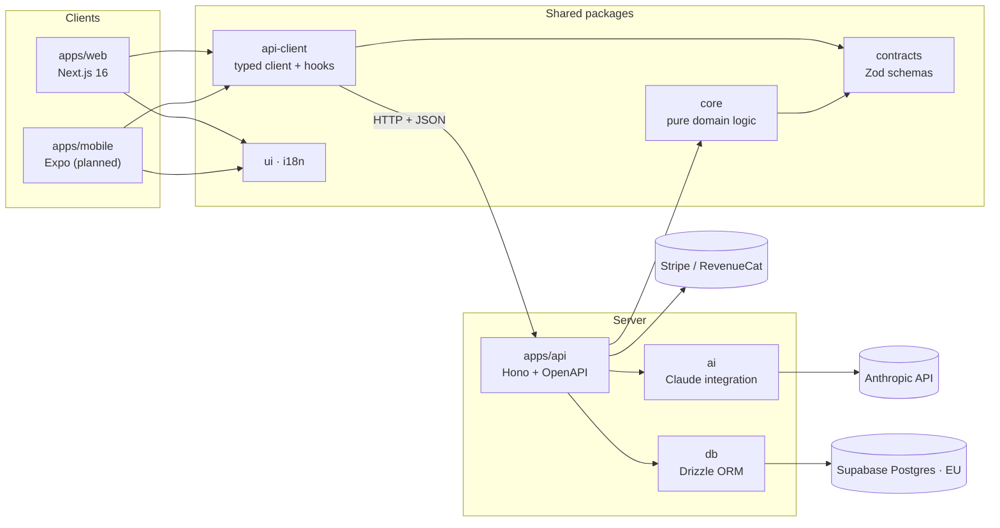

<div align="center">

# 🏋️ Personal Trainer

**AI-powered nutrition & fitness app: track meals and workouts, get personalized plans, and climb the leaderboard.**

Web-first, mobile-ready. One TypeScript monorepo, shared business logic across web, iOS and Android.

[](https://github.com/Javiguegadev/personal-trainer/actions/workflows/ci.yml)


</div>

> 🚧 **Status: in active development.** Phase 1 (foundation) is complete. See the [roadmap](#-roadmap).

---

## ✨ Features

|                                                                                |  Free   |   Premium    |
| ------------------------------------------------------------------------------ | :-----: | :----------: |
| 🍽️ **Meal tracking** with automatic calories & macros (protein, carbs, fat)    |   ✅    |      ✅      |
| 🏋️ **Workout logging**: gym, cardio, sports, with automatic PR detection       |   ✅    |      ✅      |
| 📊 **Analytics dashboard**: adherence, macro split, training volume, trends    | 7 days  | Full history |
| 🏆 **Gamification**: streaks, achievements, weekly leagues, global leaderboard |   ✅    |      ✅      |
| 🤖 **AI meal plans** tailored to goals, allergies and dietary restrictions     | Preview |      ✅      |
| 🔄 **AI healthy swaps** for the meals you actually eat                         | Preview |      ✅      |
| 📈 **AI workout programs** that adapt weekly to your progress and performance  | Preview |      ✅      |

## 🏗️ Architecture



### Key design decisions

- **Write once, run on web and mobile.** Business rules (TDEE, macros, e1RM, scoring, entitlements) live in
  `packages/core` as pure, fully unit-tested TypeScript. The Expo app will reuse all of it, plus the
  contracts, API client and translations, so only the screens are platform-specific.
- **Contracts first.** Zod schemas in `packages/contracts` are the single source of truth. They validate API
  requests, client responses, AI outputs, and generate the OpenAPI spec.
- **The AI chooses, the code computes.** Language models are bad at arithmetic. Claude picks foods and
  exercises _from our catalog_ and proposes quantities, and `core` computes every macro and training
  volume, then validates calorie targets, allergens (zero tolerance) and safe progression before a plan
  reaches the user.
- **Boundaries enforced, not just documented.** ESLint rules fail CI if client code imports the database or
  AI packages, or if `core` reaches for I/O. Secrets can't leak into client bundles by accident.
- **Privacy by design.** Health data is GDPR special-category data, so it's stored in the EU, collected with
  explicit consent, and users can export or delete it.

## 🧰 Tech stack

| Layer              | Technology                                                                   |
| ------------------ | ---------------------------------------------------------------------------- |
| Monorepo           | pnpm workspaces · Turborepo                                                  |
| Web                | Next.js 16 (App Router) · React 19 · Tailwind CSS 4 · shadcn/ui              |
| Mobile _(planned)_ | Expo · React Native · NativeWind                                             |
| API                | Hono · `@hono/zod-openapi` · Zod 4                                           |
| Data               | Supabase (Postgres, Auth, Storage) · Drizzle ORM · Row-Level Security        |
| AI                 | Claude API: structured outputs, prompt caching, Batch API · eval suite in CI |
| Payments           | Stripe Billing (web) · RevenueCat (app stores)                               |
| Quality            | TypeScript strict · ESLint · Prettier · Vitest · Playwright · GitHub Actions |

## 📁 Project structure

```
apps/
  web/            Next.js app: marketing pages + authenticated app
  api/            Hono API: every endpoint, AI calls, webhooks, background jobs
  mobile/         Expo app (Phase 10)
packages/
  core/           Pure domain logic: nutrition, training, gamification, entitlements
  contracts/      Zod schemas shared by every layer
  api-client/     Typed API client + TanStack Query hooks (web & mobile)
  db/             Drizzle schema, migrations and seeds
  ai/             Prompts, Claude client, evals, cost metering
  ui/ · i18n/     Design tokens · translations (es, en)
  config/         Shared TypeScript presets
docs/             Blueprint, architecture decision records, feature specs
```

## 🗺️ Roadmap

- [x] **Phase 1: Foundation.** Monorepo, CI, typed API with OpenAPI, enforced package boundaries
- [ ] **Phase 2: Auth & onboarding.** Supabase Auth, profile, calorie and macro targets, GDPR consent
- [ ] **Phase 3: Nutrition MVP.** Food search, barcode scanning, meal logging
- [ ] **Phase 4: Fitness MVP.** Workout logger, exercise library, PR detection
- [ ] **Phase 5: Analytics.** Trends and adherence dashboards
- [ ] **Phase 6: Gamification.** Streaks, achievements, leagues, anti-cheat
- [ ] **Phase 7: Payments.** Stripe subscriptions and entitlements
- [ ] **Phase 8: AI premium.** Meal plans, healthy swaps, adaptive workout programs
- [ ] **Phase 9: Hardening & public launch**
- [ ] **Phase 10: Mobile.** iOS and Android with Expo

The full plan is in [`docs/BLUEPRINT.md`](docs/BLUEPRINT.md).

## 🤖 Built with an AI-assisted workflow

This project is developed with [Claude Code](https://claude.com/claude-code) as a pair programmer, using a
deliberate human-in-the-loop process:

- **Spec-driven:** every feature starts as a reviewed spec with testable acceptance criteria
  ([`docs/specs`](docs/specs)).
- **Project-specific skills and agents:** repeatable recipes for migrations, endpoints, UI screens and AI
  features, plus reviewer agents for architecture boundaries and sports-science correctness
  ([`.claude/`](.claude)).
- **Guardrails as code:** hooks block edits to secrets and applied migrations, block remote database pushes
  and force-pushes, auto-format every change, and refuse to finish a task with type errors.

## 🚀 Getting started

**Requirements:** Node ≥ 22, pnpm 12 (`corepack enable`).

```bash
git clone https://github.com/Javiguegadev/personal-trainer.git
cd personal-trainer
pnpm install
cp .env.example .env      # fill in your own values
pnpm dev                  # web → http://localhost:3000 · api → http://localhost:8787/health
```

| Command       | What it does                                |
| ------------- | ------------------------------------------- |
| `pnpm dev`    | Run web and API in watch mode               |
| `pnpm check`  | Typecheck + lint + test across the monorepo |
| `pnpm build`  | Production build of every app               |
| `pnpm format` | Format with Prettier                        |

API docs are served at `http://localhost:8787/openapi.json`.

## 👤 Author

[@Javiguegadev](https://github.com/Javiguegadev)

---

<sub>⚠️ This app provides general fitness and nutrition guidance and is not a substitute for professional
medical advice.</sub>
