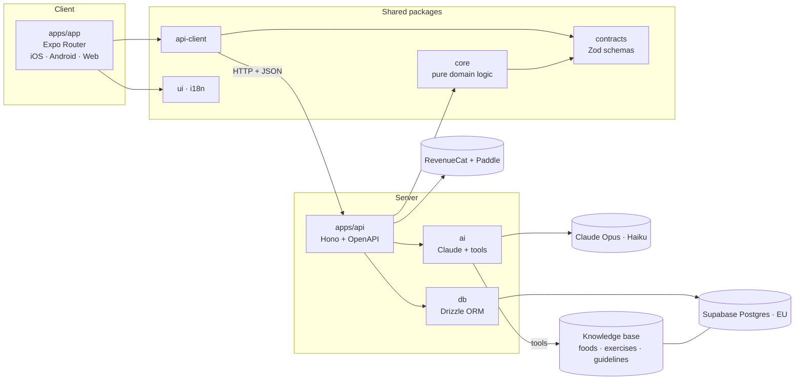

<div align="center">

# 🏋️ Personal Trainer

**An AI-first nutrition & fitness app: log meals and workouts by just telling it (or snapping a photo), and get
plans and coaching grounded in official nutrition and training data.**

Mobile-first. One Expo app for iOS, Android and the web, on a TypeScript monorepo.

[](https://github.com/Javiguegadev/personal-trainer/actions/workflows/ci.yml)


</div>

> 🚧 **Status: in active development.** The foundation is done: monorepo, CI, typed API and the universal
> Expo app. See the [roadmap](#-roadmap).

---

## ✨ Features

|                                                                                   |    Free     |  Premium  |
| --------------------------------------------------------------------------------- | :---------: | :-------: |
| 🗣️ **Log meals by text, photo or barcode** with automatic calories & macros       | Daily limit | Unlimited |
| 🏋️ **Log workouts in plain language** ("bench 4×8 at 80 kg"), with PR detection   |     ✅      |    ✅     |
| 💬 **Conversational onboarding** that sets your targets                           |     ✅      |    ✅     |
| 📊 **Daily feedback & weekly insights** on your habits                            |    Basic    | Detailed  |
| 🔄 **Healthy swaps** for the meals you actually eat                               |  3 / week   |    ✅     |
| 🍽️ **AI meal plans** tailored to goals, allergies and taste, plus a shopping list |   Preview   |    ✅     |
| 📈 **AI workout programs** that adapt every week to your progress                 |   Preview   |    ✅     |
| 🧑‍🏫 **AI coach chat** that answers from your data and cites its sources            |      –      |    ✅     |

## 🏗️ Architecture



### Key design decisions

- **One app, every platform.** A single Expo Router codebase ships to iOS, Android and the web. Business
  rules (TDEE, macros, e1RM, scoring, entitlements) live in `packages/core` as pure, unit-tested
  TypeScript, shared with the API.
- **AI-first input.** Typing "two eggs and toast" or taking a photo of the plate is faster than searching
  a database. Every AI input also has a manual fallback.
- **Grounded, not guessed.** The AI doesn't answer from memory. It queries a curated knowledge base
  (official food composition databases like BEDCA and USDA, open exercise databases, WHO/EFSA guidelines,
  study summaries) through tools, and cites what it used.
- **The AI chooses, the code computes.** Claude picks foods and exercises _from the catalog_ and proposes
  quantities. `core` computes every number and enforces safety rules (calorie floor, allergens, safe
  training progression) before anything reaches the user.
- **Right model for the job.** Claude Haiku handles high-volume, fast tasks such as logging and
  feedback. Claude Opus handles planning, coaching and weekly adaptation.
- **Boundaries enforced, not just documented.** ESLint fails CI if the app imports the database or AI
  packages, or if `core` reaches for I/O.
- **Privacy by design.** Health data is GDPR special-category data: stored in the EU, collected with
  explicit consent, exportable and deletable.

## 🧰 Tech stack

| Layer    | Technology                                                                          |
| -------- | ----------------------------------------------------------------------------------- |
| Monorepo | pnpm workspaces · Turborepo                                                         |
| App      | Expo SDK 58 · Expo Router · React Native · React 19 (iOS, Android, web)             |
| API      | Hono · `@hono/zod-openapi` · Zod 4                                                  |
| Data     | Supabase (Postgres, Auth, Storage, Cron, Queues, pgvector) · Drizzle ORM · RLS      |
| AI       | Claude API (Opus 5.5 · Haiku 5.5): tools, structured outputs, caching, Batch API    |
| Payments | RevenueCat (App Store · Google Play) · Paddle (web, Apple Pay · Google Pay · cards) |
| Quality  | TypeScript strict · ESLint · Prettier · Vitest · Playwright · GitHub Actions        |

## 📁 Project structure

```
apps/
  app/            Expo Router universal app (iOS, Android, web)
  api/            Hono API: endpoints, AI orchestration, payment webhooks
packages/
  core/           Pure domain logic: nutrition, training, scoring, entitlements, safety
  contracts/      Zod schemas shared by every layer
  api-client/     Typed API client
  db/             Drizzle schema, migrations, knowledge-base importers
  ai/             Prompts, Claude client, tools, evals, cost metering
  ui/ · i18n/     Design tokens · translations (es, en)
  config/         Shared TypeScript presets
docs/             Blueprint, architecture decision records, feature specs
```

## 🗺️ Roadmap

- [x] **Foundation.** Monorepo, CI, typed API, universal Expo app, enforced package boundaries
- [ ] **Auth & AI onboarding.** Sign-in, conversational setup, targets, GDPR consent
- [ ] **Knowledge base v1.** Spanish and international foods, exercises, MET values
- [ ] **AI food logging.** Text, photo and barcode, with a daily dashboard
- [ ] **AI workout logging.** Plain-language sets, exercise library, PRs
- [ ] **Payments.** In-app and web subscriptions with one shared Premium status
- [ ] **Premium AI.** Meal plans, adaptive programs, coach chat with citations
- [ ] **Insights & engagement.** Weekly insights, challenges, streaks
- [ ] **Launch.** Landing page, App Store and Google Play

The full plan is in [`docs/BLUEPRINT.md`](docs/BLUEPRINT.md).

## 🤖 Built with an AI-assisted workflow

This project is developed with [Claude Code](https://claude.com/claude-code) as a pair programmer, using a
deliberate human-in-the-loop process:

- **Spec-driven:** every feature starts as a reviewed spec with testable acceptance criteria
  ([`docs/specs`](docs/specs)).
- **Project-specific skills and agents:** repeatable recipes for migrations, endpoints, screens, AI features
  and knowledge-base imports, plus reviewer agents for architecture boundaries and sports-science
  correctness ([`.claude/`](.claude)).
- **Guardrails as code:** hooks block edits to secrets and applied migrations, block remote database pushes
  and force-pushes, auto-format every change, and refuse to finish a task with type errors.

## 🚀 Getting started

**Requirements:** Node ≥ 22, pnpm 12 (`corepack enable`), and the [Expo Go](https://expo.dev/go) app on
your phone to try it on a device.

```bash
git clone https://github.com/Javiguegadev/personal-trainer.git
cd personal-trainer
pnpm install
cp .env.example .env      # fill in your own values
pnpm dev                  # app → Expo dev server (press w for web) · api → http://localhost:8787/health
```

| Command       | What it does                                 |
| ------------- | -------------------------------------------- |
| `pnpm dev`    | Run the app (Expo) and the API in watch mode |
| `pnpm check`  | Typecheck + lint + test across the monorepo  |
| `pnpm build`  | API bundle + web export of the app           |
| `pnpm format` | Format with Prettier                         |

API docs are served at `http://localhost:8787/openapi.json`.

## 👤 Author

[@Javiguegadev](https://github.com/Javiguegadev)

---

<sub>⚠️ This app provides general fitness and nutrition guidance and is not a substitute for professional
medical advice.</sub>
